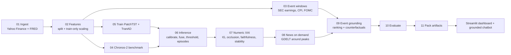

# FinAnomX — Explainable Financial Anomaly Detection with Event Grounding

FinAnomX is an **offline-first, artifacts-first** research pipeline for explainable anomaly analysis on U.S. equities. It does more than produce an anomaly score. For each detected anomaly episode it answers three questions:

1. **What was abnormal?** Transformer-based detectors (PatchTST forecast residuals + TranAD reconstruction error) flag abnormal days and group them into episodes.
2. **Which inputs drove the score?** Feature- and time-level attribution, checked with faithfulness (deletion) and stability (date-jitter) tests.
3. **Which real-world event plausibly explains it?** Targeted news retrieval runs *only* around detected peaks. The retrieved evidence is ranked and then stress-tested with counterfactual query ablation.

The results are packaged for a **Streamlit dashboard** and a **grounded chatbot**. The chatbot answers deterministically from the artifacts and can optionally phrase its answers with a local LLM via Ollama.

> Team course project for **DAP391m (FPT University)** by Đinh Đức Đạt and Trần Ngọc Minh; see [Team & acknowledgements](#team--acknowledgements).

---

## Key features

- **Leak-free time-series setup:** chronological split (train ≤ 2022, validation 2023, test 2024). Scalers and score calibration are fit on the training period only.
- **Two-branch detector:** PatchTST (forecast residual) and TranAD (reconstruction). Each branch is calibrated to train-percentiles and the two are fused, with static and adaptive (rolling-quantile) thresholds.
- **Benchmarking:** compared against **Amazon Chronos-2**, a pretrained time-series foundation model.
- **Numeric XAI:**
  - Integrated Gradients on the PatchTST branch
  - Occlusion sensitivity on the TranAD branch
  - Faithfulness via feature/time deletion
  - Stability via ±3-day date jitter
- **Event grounding:**
  - GDELT news search around each episode peak, with article text extraction
  - Ranking by embedding similarity (Ollama `nomic-embed-text`), FinBERT sentiment, domain quality, and consistency with the market move and the XAI features
  - Earnings (SEC EDGAR) and macro (CPI/FOMC) event windows
- **Counterfactual validation:** retrieval is re-run with the company-only, event-only, no-macro and XAI-only query variants, to test whether the top-ranked explanation depends on the evidence it claims.
- **Analyst UI:** Streamlit dashboard with Plotly charts and a grounded chatbot (rule-based intents, artifact retrieval, output validators).

## Pipeline



| Step | Script | Main outputs |
|---|---|---|
| 00 | `src/00_preflight.py` | Environment, folder and dependency checks |
| 01 | `src/01_ingest_raw.py` | `data/raw/raw_merged.parquet` |
| 02 | `src/02_process_data.py` | `data/processed/features.parquet`, `scaled.parquet`, `models/scalers/` |
| 03 | `src/03_build_event_windows.py` | `data/external/event_seed_*.csv`, `data/results/event_windows.csv` |
| 04 | `src/04_baselines.py` | Chronos-2 benchmark scores |
| 05 | `src/05_train_models.py` | `models/dl/patchtst_forecaster.pth`, `tranad_detector.pth` |
| 06 | `src/06_infer_anomalies.py` | `data/results/anomalies_base.csv` |
| 07 | `src/07_xai_numeric.py` | `xai_feature.csv`, `xai_temporal.json`, `xai_faithfulness.csv`, `xai_stability.csv` |
| 08 | `src/08_news_on_demand.py` | `news_enriched.parquet` (+ cache) |
| 09 | `src/09_event_grounding.py` | `event_attribution.csv`, `event_counterfactual.csv` |
| 10 | `src/10_evaluate.py` | Detection and explanation metric tables |
| 11 | `src/11_pack_for_web.py` | `anomalies.csv`, `chat_evidence.jsonl` |

## Tech stack

| Area | Tools |
|---|---|
| Language | Python ≥ 3.10 |
| Data | pandas, NumPy, PyArrow, yfinance, fredapi, requests |
| Modelling | PyTorch, PatchTST and TranAD (third-party, see below), Amazon Chronos-2 (`chronos-forecasting`), scikit-learn, ruptures |
| NLP / retrieval | GDELT DOC API, BeautifulSoup + lxml, trafilatura, Hugging Face Transformers (FinBERT), Ollama embeddings |
| App | Streamlit, Plotly, streamlit-plotly-events, Ollama (optional local LLM) |

## Getting started

```bash
git clone <this-repo>
cd FinAnomX
python -m venv .venv
source .venv/bin/activate          # Windows: .venv\Scripts\activate
pip install -r requirements.txt
cp .env.example .env               # then fill in FRED_API_KEY and SEC_USER_AGENT
```

Install [Ollama](https://ollama.com) and pull the models named in `.env`. The embedding model (`nomic-embed-text`) is **required** by step 09 (event grounding). The chat LLM is optional: without it, the chatbot falls back to deterministic grounded answers.

### Run the pipeline

```bash
python src/00_preflight.py
python src/01_ingest_raw.py
python src/02_process_data.py
python src/03_build_event_windows.py
python src/04_baselines.py
python src/05_train_models.py
python src/06_infer_anomalies.py
python src/07_xai_numeric.py
python src/08_news_on_demand.py
python src/09_event_grounding.py
python src/10_evaluate.py
python src/11_pack_for_web.py
```

### Run the dashboard

```bash
streamlit run app/streamlit_app.py
```

The dashboard reads from `data/results/`, so the pipeline must be run first. No market data, news text or trained models are shipped with this repository; see [DATA.md](DATA.md) for the reasons and the regeneration route.

## Results

The numbers below are copied from the experiment snapshot in [`results/`](results/) (2023–2024 analysis window, 4 tickers, adaptive thresholds). They are reported as produced and were not re-run for this repository.

**Point-wise detection** (`results/model_comparison_adapt.csv`; ground truth = same-day return/volume shocks, positive rate 2.8%):

| Model | AUROC | AUPRC | Precision | Recall | F1 |
|---|---|---|---|---|---|
| Chronos-2 benchmark | 0.789 | **0.390** | **0.292** | **0.464** | **0.359** |
| TranAD | **0.818** | 0.070 | 0.121 | 0.429 | 0.188 |
| PatchTST + TranAD (fused, main detector) | 0.798 | 0.062 | 0.127 | 0.232 | 0.165 |
| PatchTST | 0.554 | 0.031 | 0.035 | 0.232 | 0.061 |

**Event-level hit rate** (`results/eval_detection_episode.csv`, 208 earnings/macro event windows): TranAD 0.255, Chronos-2 0.212, fused 0.091.

**Explanation layer** (`results/eval_explain.csv`, 25 episode peaks):

| Metric | Value |
|---|---|
| Faithfulness pass rate (deletion test) | 1.00 |
| Mean top-5 feature overlap under ±3-day jitter | 0.63 |
| Mean top-1 grounding confidence | 0.795 |
| Top-1 evidence with full article text | 84% |
| Mean counterfactual strength | 0.803 |
| Peaks with strong counterfactual support | 84% |

### Interpretation and limitations

- **The fused detector does not beat the Chronos-2 benchmark** on AUPRC or F1, and the PatchTST branch is weak under the point-wise protocol. The ground truth rewards same-day shocks, while the detectors respond to multi-day window abnormalities. The project's main contribution is the explanation and grounding layer, not detection accuracy.
- The explanation metrics measure internal consistency (faithfulness, stability, retrieval confidence). They are **not** a human-validated measure of whether the explanation is causally correct.
- Results cover 4 large-cap tickers over two years (25 episode peaks), which is too small a sample for strong general claims.
- News retrieval depends on live GDELT and publisher sites, so a re-run can return different articles.

### Known inconsistencies (documented for transparency)

- **Proposal vs. implementation:**
  - The research proposal listed AAPL; the implementation uses TSLA, AMZN, NVDA and MSFT.
  - The proposal mentioned FAISS; the implementation computes cosine similarity on Ollama embeddings directly.
  - Integrated Gradients is implemented natively in PyTorch rather than via Captum.
- **Two versions of the comparison table:** `results/model_comparison.csv` and `results/model_comparison_adapt.csv` report different adaptive-threshold numbers for the same models (e.g., fused AUROC 0.830 vs 0.798). The table above uses `model_comparison_adapt.csv`, which matches the course report.
- **Legacy evaluation file:** `results/eval_detection.csv` uses a different ground-truth definition (positive rate 7.1%) and includes baselines (Isolation Forest, OCSVM, PCA, DLinear, LSTM-AE) that are not produced by the current `src/` scripts. It appears to come from an earlier version of the pipeline and is kept only for completeness.
- A few source comments are written in Vietnamese.

## Project structure

```text
FinAnomX/
├── README.md, DATA.md, requirements.txt, .env.example, .gitignore
├── config.py                  # paths, universe, time splits, hyperparameters
├── src/                       # pipeline steps 00–11 + utils/
├── app/                       # Streamlit app, data access layer, UI components
│   └── chatbot/               # intent parsing, retrieval, responders, validators, Ollama client
├── external/                  # verified minimal subset of third-party model code
│   ├── PatchTST/              # Apache-2.0 (see THIRD_PARTY.md)
│   └── TranAD/                # BSD-3-Clause (see THIRD_PARTY.md)
├── data/external/             # public earnings / macro event calendars
└── results/                   # aggregate metric snapshot + small anomaly sample
```

## Third-party code & credits

FinAnomX **uses, but did not create**, the following models:

- **PatchTST**: Nie, Nguyen, Sinthong & Kalagnanam, *A Time Series is Worth 64 Words: Long-term Forecasting with Transformers*, ICLR 2023. [yuqinie98/PatchTST](https://github.com/yuqinie98/PatchTST), Apache-2.0.
- **TranAD**: Tuli, Casale & Jennings, *TranAD: Deep Transformer Networks for Anomaly Detection in Multivariate Time Series Data*, VLDB 2022. [imperial-qore/TranAD](https://github.com/imperial-qore/TranAD), BSD-3-Clause.
- **Chronos-2**: Amazon, used as an external benchmark via `chronos-forecasting`.
- **FinBERT**: `ProsusAI/finbert` via Hugging Face Transformers, used for news sentiment.

Only the PatchTST and TranAD files the pipeline imports are included under `external/`. Each one was verified byte-for-byte against a pinned upstream commit and is **unmodified**. The commit hashes and verification table are in each `external/*/THIRD_PARTY.md`, and the original LICENSE files are kept.

Data sources: Yahoo Finance, FRED (Federal Reserve Bank of St. Louis), SEC EDGAR, and the GDELT Project. See [DATA.md](DATA.md).

## Team & acknowledgements

FinAnomX was developed as a team course project for DAP391m at FPT University. Credits are organized into two groups: core project contributors and academic guidance. Third-party components remain credited to their original authors (see [Third-party code & credits](#third-party-code--credits)).

### Core project contributors

*Đinh Đức Đạt*

- Exploratory data analysis (EDA)
- Research report writing
- Presentation slide preparation

*Trần Ngọc Minh* (technical implementation)

- Data ingestion and preprocessing pipeline
- Integration and implementation of the PatchTST and TranAD models within the FinAnomX pipeline (training, inference, calibration)\*
- Anomaly detection, scoring and evaluation
- Explainable AI and feature attribution
- News retrieval, event grounding and counterfactual validation
- Streamlit dashboard and grounded chatbot

\* The PatchTST and TranAD model architectures and their original code are by their respective authors (see [Third-party code & credits](#third-party-code--credits)). The contribution listed here covers adapting and using them in this project, not the models themselves.

### Academic guidance

- **Mrs. Lê Võ Minh Thư** (FPT University), academic mentor for this course project. Her guidance consisted mainly of feedback and comments, reviewing the report, and requesting revisions to the LaTeX manuscript.

> The research report and presentation slides are not included in this repository.

## License

No license has been chosen yet for the FinAnomX code, so all rights are reserved by the authors for now. The repository is intended to be shared **privately** at first; a public release will be considered after review. The third-party code in `external/` stays under its original licenses (Apache-2.0 and BSD-3-Clause).
